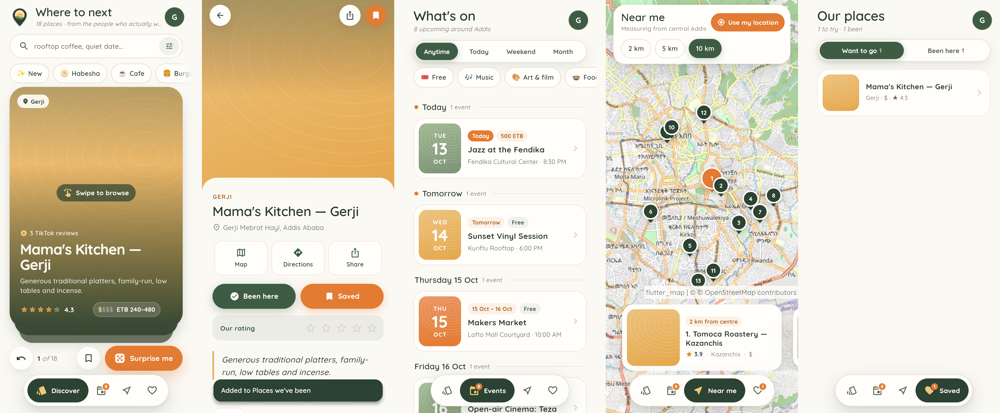

# spots — Flutter app

A native Android/iOS (and web) take on the spots frontend. Same Supabase
project, same tables and RLS, same warm editorial look as `apps/web`, built
around a phone in one hand.



## What's in it

- **Discover** — the "surprise me" deck as a stack of swipeable cards. Swipe
  either way to move on, the back button to return, *Surprise me* to jump
  somewhere random. Category chips (with icons) float above the deck; search, area, price and sort
  live in a pull-up sheet.
- **Spot page** — the cover expands from the card into a full-bleed header
  with the rest pulled up over it as a sheet: watch the TikTok review, Maps,
  directions, share, *Been here* / *Want to go*, our own star rating (five
  stars earns confetti), the quality breakdown, price band and a map.
- **Events** — published `happenings` grouped by Addis day, with a floating
  *Anytime / Today / Weekend / Month* switch, kind chips and *Free*. Each
  event opens a sheet with *Add to calendar*, tickets and the original post.
- **Near me** — a full-screen map with numbered pins and a card rail floating
  above the tabs, sorted by estimated road distance. Location is one-shot and
  never leaves the phone.
- **Saved** — *Want to go* (swipe a row away to remove it) and *Been here*,
  where each visit gets stars, the five dimension sliders and notes.

Navigation is a floating pill tab bar; the active tab grows into a deep-green
capsule with its label.

The date/time logic (Addis wall-clock, event dedupe, weekend windows), the
road-distance estimate, categories and price bands are ported one-to-one from
`apps/web/src/lib`, so both apps answer the same questions the same way.

## Run it

```bash
cd apps/mobile
flutter pub get
flutter run                     # demo data, no keys needed
```

Without keys the app runs on the design mock (`design/data/spots-data.js`,
exported to `assets/data/demo_spots.json`), generated sample events, and keeps
the personal lists on the device.

Against the real project, pass the same URL + publishable key the web uses
(`VITE_SUPABASE_URL` / `VITE_SUPABASE_PUBLISHABLE_KEY` in the root `.env`):

```bash
flutter run \
  --dart-define=SUPABASE_URL=https://<ref>.supabase.co \
  --dart-define=SUPABASE_PUBLISHABLE_KEY=<publishable key> \
  --dart-define=WEB_ORIGIN=https://<where the web app lives>   # optional: share links land on the web card
```

### Google sign-in

The app signs in through Supabase OAuth and comes back on the deep link
`spots://login-callback` (already wired in
`AndroidManifest.xml` and `Info.plist`). Add that URL under
**Supabase → Authentication → URL Configuration → Redirect URLs**.

### Map tiles

Defaults to the standard OpenStreetMap tiles. CARTO's Voyager basemap (the
web's Leaflet fallback) now answers without an API key with an
"API KEY REQUIRED" watermark, so it isn't the default. To use another
provider:

```bash
--dart-define=MAP_TILE_URL='https://…/{z}/{x}/{y}.png' --dart-define=MAP_ATTRIBUTION='© …'
```

## Checks

```bash
dart format --set-exit-if-changed lib test
flutter analyze
flutter test        # logic ports + widget smoke tests on demo data
```

CI runs the same three on any PR touching `apps/mobile`
(`.github/workflows/mobile.yml`).

## Layout

```
lib/
  main.dart               picks Supabase or demo backend, boots the app
  theme/                  tokens mirrored from styles.css (:root), ThemeData
  models/                 Spot, Happening, Visit (snake_case JSON in)
  logic/                  pure ports of web lib/: happenings, geo, format, categories
  data/                   Backend interface, SupabaseBackend, DemoBackend
  state/app_state.dart    one ChangeNotifier + AppScope (InheritedNotifier)
  screens/                shell (floating tabs), discover, events, near, saved, spot detail
  widgets/                swipe deck, spot card, floating nav, segmented tabs, dice, map, …
assets/fonts/             Quicksand 400–700 (static cuts of the variable font, OFL)
```

Not ported yet: the admin tools (spot/event editors, review queue, team),
Spot Matches, the feedback launcher and first-party analytics.
